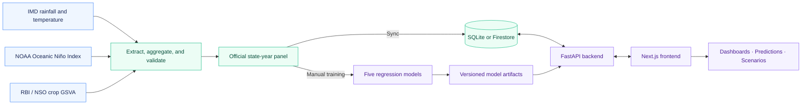

<div align="center">

# 🌾 El Niño & Indian Crops

### State Crop GSVA Explorer

**Climate data. Economic insight. Five machine learning perspectives.**

Explore how rainfall, temperature, and El Niño relate to the value of crop production across Indian states.

<p>
  
  
  
  
</p>

[Features](#features) · [Quick Start](#quick-start) · [Methodology](#data-and-methodology) · [API Reference](#api-reference)

**K. J. Somaiya Institute of Technology**<br />
Department of Artificial Intelligence and Data Science · Project-Based Learning

</div>

---

## Overview

**Crop GSVA Explorer** is a full-stack climate and agricultural economics platform. It brings together official weather data, the Oceanic Niño Index (ONI), and state economic records in an interactive workspace for historical analysis, model comparison, and hypothetical climate scenarios.

The Next.js frontend turns the state-year panel into maps, charts, and searchable records. The FastAPI backend serves the data, runs predictions, compares scenarios, and manages versioned model artifacts. Local SQLite storage supports development without Firebase credentials; Firestore and Cloud Storage are available when configured.

| Coverage | Modeling window | Prepared dataset | Regression models |
| :---: | :---: | :---: | :---: |
| **28 Indian states** | **FY 2011–12 → FY 2024–25** | **385 complete state-years** | **5 model families** |

*Dataset figures describe the current [official panel report](data/processed/official_panel_report.json). Union Territories are outside the state catalogue.*

> **What does the platform estimate?**<br />
> Crop **Gross State Value Added (GSVA)** at constant 2011–12 prices, measured in **₹ crore**. This is the value added by crop production within a state—not total GDP, all-sector GSDP, or the combined agriculture, forestry, and fishing sector.

## Features

| | Workspace | What you can do |
| :---: | --- | --- |
| 📊 | **Dashboard** | Explore state coverage, historical trends, climate indicators, and an interactive India map. |
| 🗺️ | **State profiles** | Inspect an individual state's climate and crop-GSVA history. |
| 🌦️ | **Prediction studio** | Enter a state, rainfall, temperature, and ONI to compare model estimates. |
| 🧪 | **Scenario Lab** | Explore neutral ENSO, weak/moderate/strong El Niño, La Niña, or custom conditions against historical baselines. |
| 🧠 | **Model comparison** | Compare five regressors using error metrics, feature importance, and training-run details. |
| 🔎 | **AI Search** | Ask supported climate, historical-data, prediction, and scenario questions through intent-based routing and a curated knowledge base. |
| 🗃️ | **Data Explorer** | Browse and filter the official panel; export data and model metrics as CSV or JSON. |
| 📖 | **Methodology & workflow** | Review source definitions, modeling assumptions, and the manual preparation and training sequence. |

The search assistant uses the project's knowledge base and analytical services; no external LLM API key is required.

## Architecture



| Layer | Technologies |
| --- | --- |
| **Frontend** | Next.js 14 · React 18 · TypeScript · Tailwind CSS |
| **Charts & interaction** | Recharts · React Simple Maps · Framer Motion · Lucide icons |
| **Backend** | FastAPI · Uvicorn · Pydantic |
| **Data processing** | pandas · NumPy · SciPy · pdfplumber |
| **Machine learning** | scikit-learn · XGBoost · joblib |
| **Storage** | SQLite and local files · optional Firebase Firestore and Cloud Storage |

## Quick start

### 1. Install dependencies

Use **Python 3.10+**, **Node.js 18.17+**, and **npm**. The commands below use Windows PowerShell and start from the repository root.

```powershell
# Backend environment
python -m venv backend\.venv
& .\backend\.venv\Scripts\python.exe -m pip install -r backend\requirements.txt

# Frontend dependencies
cd frontend
npm ci
cd ..
```

If `backend/.venv` already exists, skip creating it. Firebase configuration is optional for local use.

### 2. Start the backend

Open a terminal at the repository root:

```powershell
cd backend
& .\.venv\Scripts\python.exe -m uvicorn app.main:app --reload --host 127.0.0.1 --port 8000
```

### 3. Start the frontend

Open a second terminal at the repository root:

```powershell
cd frontend
npm run dev
```

| Service | Local address |
| --- | --- |
| **Application** | [localhost:3000](http://localhost:3000) |
| **Interactive API docs** | [localhost:8000/docs](http://localhost:8000/docs) |
| **API health check** | [localhost:8000/health](http://localhost:8000/health) |

**Using the existing prepared workspace?** Start both services and open the dashboard. Data views use the synced official panel; predictions and scenarios use a compatible trained run. For a fresh checkout without the data and artifacts, follow [Prepare data and train](#prepare-data-and-train). Large raw source files are excluded from Git.

<details>
<summary><strong>Configuration: API address, CORS, and optional Firebase</strong></summary>

Set a custom backend address in `frontend/.env.local`:

```dotenv
NEXT_PUBLIC_API_BASE_URL=http://localhost:8000
```

Restart the frontend after changing this value.

For Firebase, create `backend/.env` using [backend/.env.example](backend/.env.example) and replace the placeholders with your project settings:

```dotenv
FIREBASE_PROJECT_ID=your-project-id
FIREBASE_STORAGE_BUCKET=your-project-id.firebasestorage.app
GOOGLE_APPLICATION_CREDENTIALS=./serviceAccountKey.json
```

The relative credential path above assumes the backend is started from `backend/`. For root-level data scripts, use an absolute credential path and set the same Firebase variables in that terminal so both processes use the same storage. Keep service-account credentials out of version control. For SQLite-only use, leave the Firebase settings unset rather than copying placeholder values.

The backend also accepts `CORS_ORIGINS`, a comma-separated list of frontend origins. Defaults include `http://localhost:3000`, `http://127.0.0.1:3000`, and `http://localhost:3001`.

</details>

## Data and methodology

### From daily climate records to annual economic observations

| Input | Source | Preparation |
| --- | --- | --- |
| **Rainfall** | IMD daily 0.25° NetCDF grids | Sum daily rainfall within each April–March financial year. |
| **Temperature** | IMD daily 1° Tmax/Tmin GRD grids | Average daily `(Tmax + Tmin) / 2` within the financial year. |
| **ENSO** | NOAA CPC Oceanic Niño Index | Average ten complete overlapping three-month seasons within the financial year. |
| **Crop GSVA** | RBI/NSO state economic table | Extract the crops series at constant 2011–12 prices, in ₹ crore. |

Each row represents **one state × one financial year**. The `year` column stores the start year: `2011` means FY 2011–12. Climate data is sampled from the nearest grid cell to one documented [representative point per state](data/metadata/state_representative_points.csv), then joined to the economic target.

Of **392 candidate state-years**, **385 have complete inputs and targets**. Seven missing official targets are excluded rather than imputed. The panel preparation checks at least 95% daily climate coverage and records source hashes and exclusions for review.

### Five models, one comparison framework

| Model | Role |
| --- | --- |
| **Linear Regression** | An interpretable linear benchmark. |
| **Random Forest** | An ensemble of decision trees for nonlinear relationships. |
| **Extra Trees** | A randomized tree ensemble for comparison with Random Forest. |
| **Gradient Boosting** | Sequential trees that learn from residual errors. |
| **XGBoost** | Gradient-boosted trees using the XGBoost implementation. |

All five models use **rainfall, mean temperature, ONI, and one-hot state identity**. The year determines the chronological split; it is not a predictor. Earlier years form the training partition and later years form the held-out test partition.

The platform reports **MAE and RMSE in ₹ crore**, **R² as a dimensionless score**, and **MAPE as a percentage**. The displayed best model has the lowest held-out RMSE. View the active run in the Models page or through `/api/models/comparison`; scores from the legacy sample dataset do not describe the official panel.

<details>
<summary><strong>Research scope and interpretation</strong></summary>

- Climate features are **grid-point proxies**, not state-area averages or station observations. A selected cell can fall outside the state boundary, particularly with Goa's coarse temperature grid.
- State identity captures persistent differences in economic scale. A high pooled R² alone does not demonstrate climate-prediction skill; examine per-state errors and compare simple baselines.
- The best model is selected using the same held-out RMSE reported in the app. A separate validation partition and untouched final test would give a stronger assessment of the selected model.
- Scenario outputs are conditional model estimates. They do not establish that El Niño or a changed climate input causes a particular economic outcome.
- Earlier climate downloads are retained, but the comparable selected economic series begins in FY 2011–12. Older MoSPI series with different price bases are not blended into this target. Basin polygons and river-streamflow downloads are outside the active crop-GSVA model.
- The compatibility field `agricultural_gdp_cr` refers to crop GSVA in the official workflow.

</details>

## Prepare data and train

Use this sequence when setting up the official dataset or deliberately rebuilding it. Place the source downloads in the locations documented in [Raw data and provenance](data/raw/README.md), then run the following from the repository root.

```powershell
# Install the PDF extraction dependency
& .\backend\.venv\Scripts\python.exe -m pip install -r scripts\requirements-economic.txt

# 1. Extract economic tables
& .\backend\.venv\Scripts\python.exe scripts\extract_economic_targets.py --overwrite

# Review data/interim/economic/extraction_issues.csv before continuing.

# 2. Build the financial-year panel
& .\backend\.venv\Scripts\python.exe scripts\prepare_official_panel.py --overwrite

# Review data/processed/official_panel.csv and official_panel_report.json.

# 3. Sync the reviewed panel to the configured storage
& .\backend\.venv\Scripts\python.exe scripts\sync_official_panel.py

# 4. Train and compare all five models
& .\backend\.venv\Scripts\python.exe scripts\train_models.py
```

The sync step validates source and panel hashes and refuses to replace a different existing official panel. It writes to the configured storage, including Firestore when enabled. Training saves versioned artifacts and metrics; serving checks that the active model run matches the official panel.

Training is an explicit command-line step. The legacy one-click `/api/train` and `/api/pipeline/run` endpoints are disabled for this workflow. The older download/preprocessing scripts are not substitutes for the sequence above.

**Further reading:** [Official panel workflow](scripts/OFFICIAL_PANEL_WORKFLOW.md) · [Economic extraction](scripts/ECONOMIC_EXTRACTION.md) · [Raw data and provenance](data/raw/README.md)

## API reference

With the backend running, use [Swagger UI](http://localhost:8000/docs) to inspect request schemas and try the endpoints.

| Method | Endpoint | Purpose |
| --- | --- | --- |
| `GET` | `/health` | Service health. |
| `GET` | `/api/dashboard/summary` | Dataset and model overview. |
| `GET` | `/api/states` | State catalogue and availability. |
| `GET` | `/api/states/{state}/history` | Historical state observations. |
| `GET` | `/api/data` | Filtered panel records. |
| `GET` | `/api/models/comparison` | Active model metrics and comparison. |
| `GET` | `/api/models/runs` | Training-run history. |
| `POST` | `/api/predict` | Crop-GSVA estimates for supplied climate inputs. |
| `GET` | `/api/scenario/presets` | Available hypothetical climate presets. |
| `POST` | `/api/scenario` | Scenario estimates and baseline comparison. |
| `POST` | `/api/search` | Route supported questions to knowledge and analytical services. |
| `GET` | `/api/export/panel` | Download panel data as CSV or JSON. |
| `GET` | `/api/export/metrics` | Download model metrics as JSON or CSV. |

## Project structure

```text
.
├── frontend/                 # Next.js application
│   ├── app/                  # Dashboard, models, predictions, scenarios, and more
│   ├── components/           # Charts, maps, navigation, and reusable UI
│   └── lib/                  # API client, constants, and utilities
├── backend/
│   ├── app/
│   │   ├── routers/          # FastAPI endpoints
│   │   ├── services/         # Storage, ingestion, ML, scenarios, and search
│   │   └── models/           # Request and response schemas
│   └── tests/                # Backend regression tests
├── data/
│   ├── raw/                  # Original source downloads
│   ├── interim/              # Extracted economic tables and derived climate data
│   ├── metadata/             # Source provenance and representative points
│   ├── processed/            # Official panel and validation report
│   ├── models/official/      # Versioned official-panel model artifacts
│   └── pbl_database.sqlite   # Local database
├── scripts/                  # Extraction, preparation, sync, and training
└── sample_data/              # Legacy sample data, separate from the official panel
```

<details>
<summary><strong>Troubleshooting</strong></summary>

| Symptom | What to check |
| --- | --- |
| Frontend cannot reach the API | Confirm `/health` responds, check `NEXT_PUBLIC_API_BASE_URL`, and restart the frontend after changing it. |
| Browser reports a CORS error | Ensure the frontend origin is included in the backend's `CORS_ORIGINS`. |
| Data pages are empty | Validate and sync the official panel to the same storage used by the backend. |
| Predictions or scenarios are unavailable | Check for a compatible official training run and its artifacts; complete the manual training step if needed. |
| Sync reports a source or panel mismatch | Review the source files and validation report, then rebuild the affected preparation steps. |
| npm reports a missing `npm-cli.js` | Repair the Node.js/npm installation. If dependencies already exist, run `node node_modules/next/dist/bin/next dev` from `frontend/` as a temporary launcher. |

</details>

---

<div align="center">

**Built to explore the connection between climate and Indian crop production.**

An educational research project at **K. J. Somaiya Institute of Technology**.<br />
Source attribution: **IMD · NOAA CPC · RBI/NSO**. See the [provenance notes](data/raw/README.md) for dataset references.

<sub>Analytical estimates for research and learning. Outputs are not official government forecasts.</sub>

</div>
